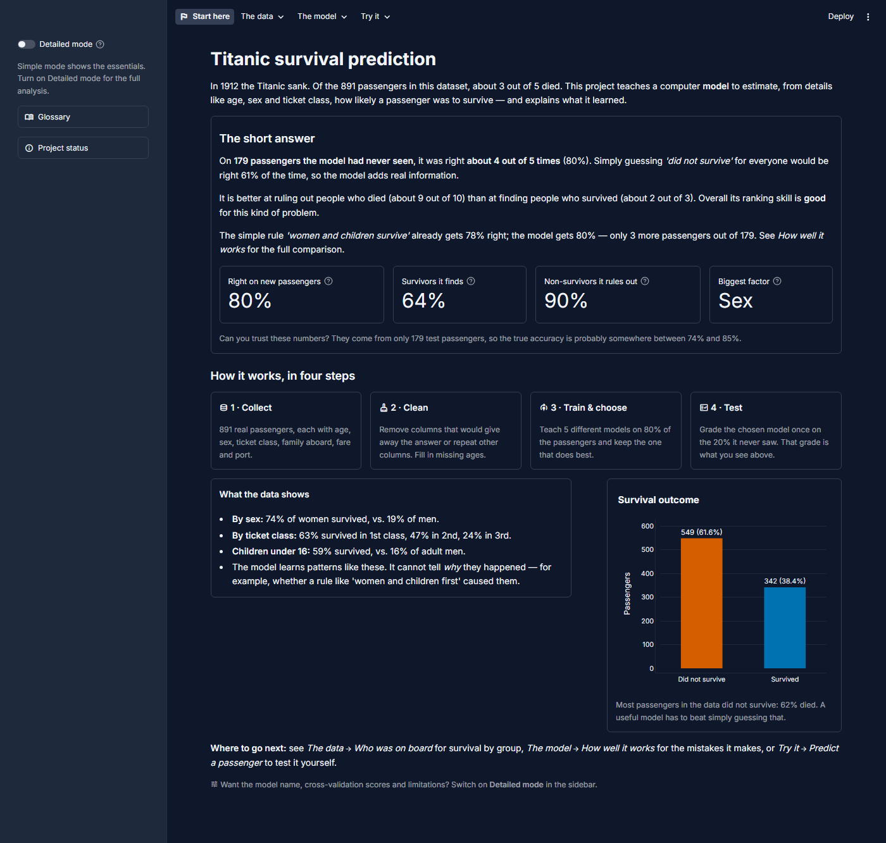
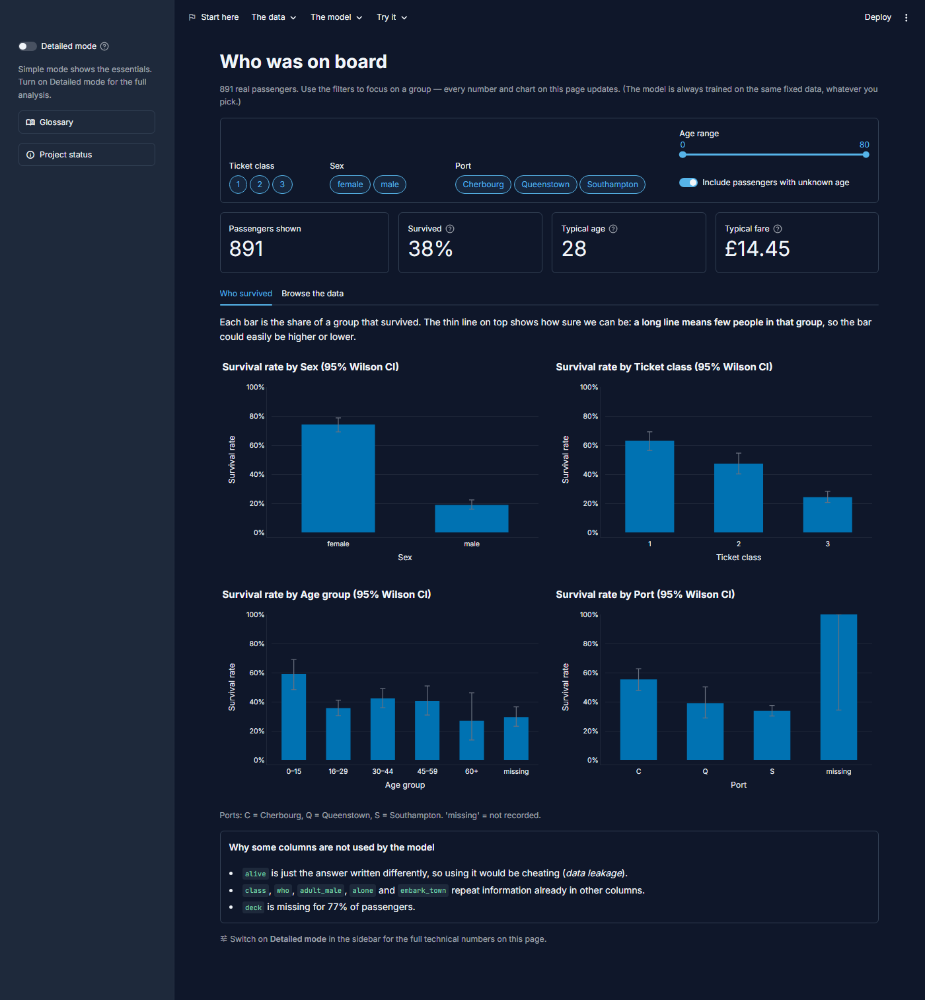
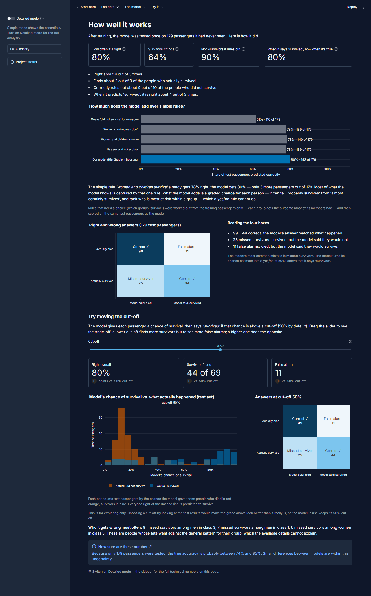
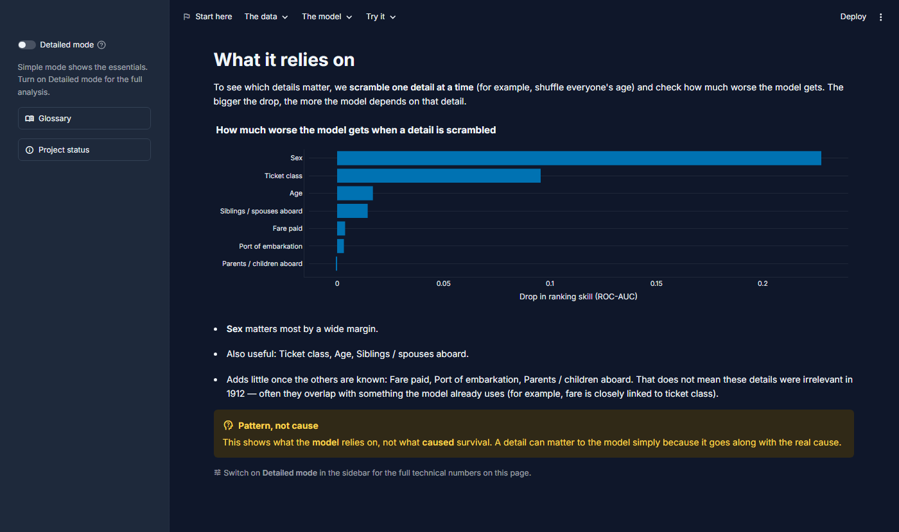
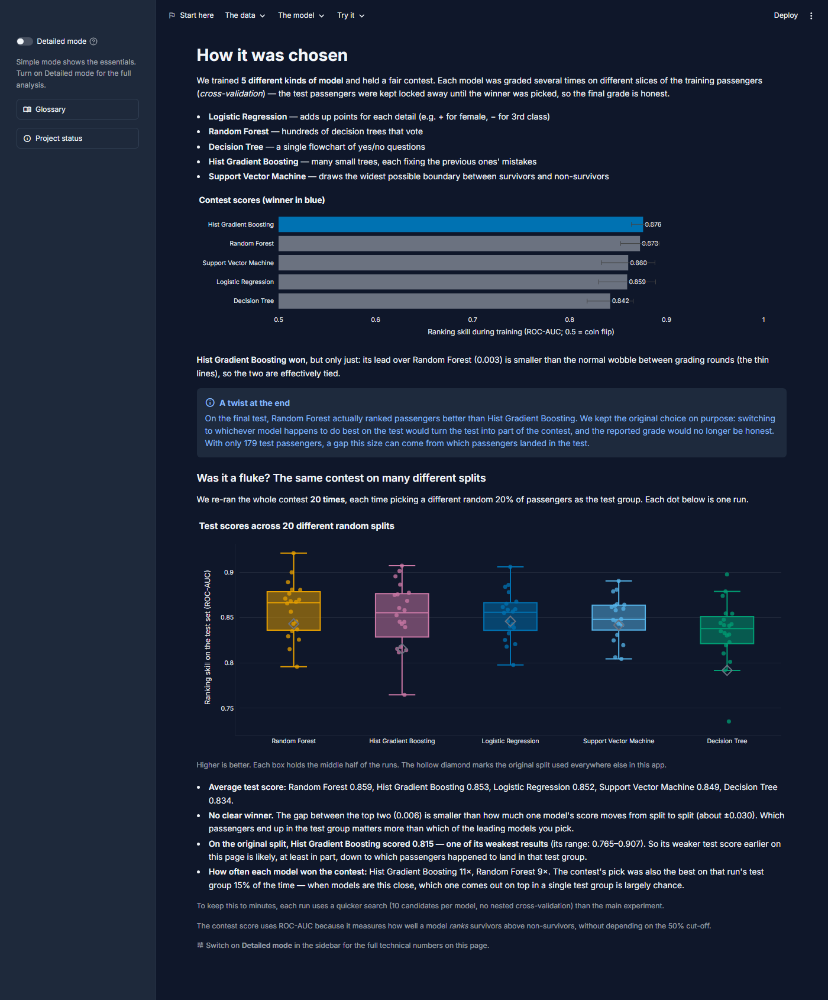
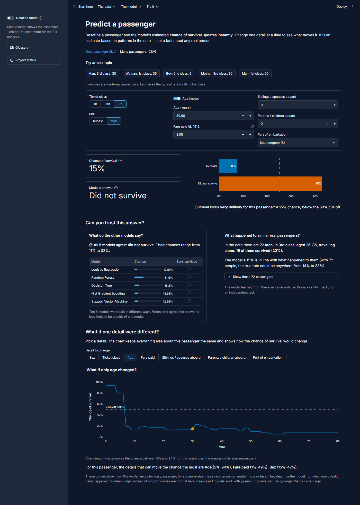
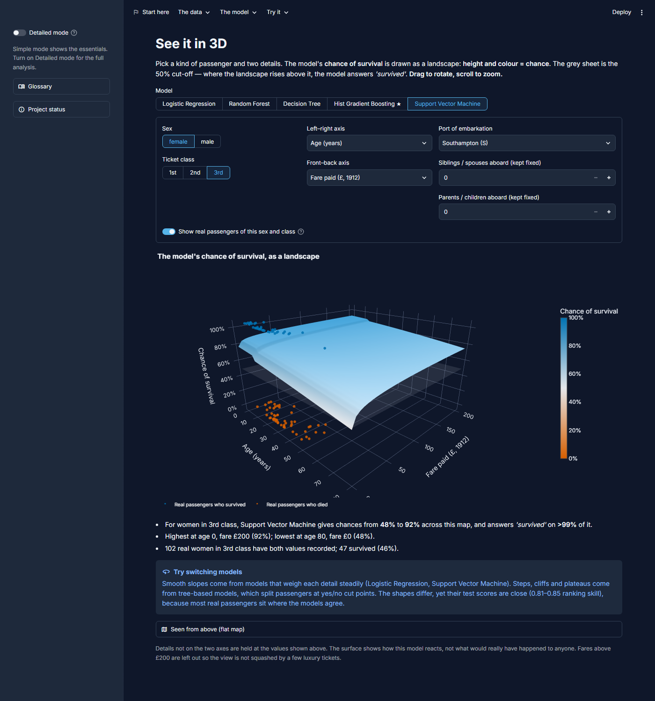

# Titanic survival prediction — an end-to-end ML project

A reproducible, leakage-safe classification project that predicts whether a Titanic passenger
survived, compares five tuned models with nested cross-validation, reports test performance with
bootstrap confidence intervals, explains the models, and serves everything through a Streamlit
dashboard with individual/batch prediction and a PDF report.

It grew out of an introductory course notebook (IBM Skills Network *"Practice Project: Titanic
Survival Prediction"*). The notebook is IBM course material ("© IBM Corporation. All rights
reserved."), so it is kept unchanged locally in `notebooks/` but is not published in this repository.
The [notebook review](#what-changed-from-the-notebook-and-why) explains what was kept and what was corrected.

---

## Problem definition

- **Task:** binary classification, `survived` ∈ {0, 1}.
- **Inputs:** information known at boarding — ticket class, sex, age, siblings/spouses and
  parents/children aboard, fare, port of embarkation.
- **Primary metric:** ROC-AUC, fixed before any test evaluation (threshold-independent and robust
  to the ~38/62 class imbalance). Accuracy, precision, recall, specificity, F1, balanced accuracy,
  PR-AUC, MCC and Brier score are also reported.

## Dataset

| | |
|---|---|
| Source | The seaborn `titanic` dataset that the notebook loads with `sns.load_dataset('titanic')`, i.e. [`mwaskom/seaborn-data/titanic.csv`](https://github.com/mwaskom/seaborn-data/blob/master/titanic.csv) |
| Size | 891 rows × 15 columns (the Kaggle training subset; 342 survivors, 38.4%) |
| Integrity | SHA-256 pinned in `config.py`; the downloader rejects any other file |
| Location | `data/raw/titanic.csv` (not committed) |

**Setup:** `python -m src.data.loader` downloads and verifies the file.

### Data-quality findings (all verified in code — `src/data/profiling.py`)

| Column | Finding | Decision |
|---|---|---|
| `alive` | identical to the target (`yes` ⇔ `survived = 1`) | **excluded — target leakage** |
| `class` | one-to-one with `pclass` | excluded (duplicate) |
| `who` | exactly `child` if age < 16, else `man`/`woman` by sex (missing ages fall back to sex) | excluded; replaced by an engineered `is_child` flag + missing-age indicator |
| `adult_male` | exactly `who == 'man'` | excluded (derived) |
| `alone` | exactly `sibsp + parch == 0` | excluded (derived) |
| `embark_town` | one-to-one with `embarked` | excluded (duplicate) |
| `deck` | 77% missing | excluded |
| `age` | 19.9% missing | median-imputed **inside each training fold** + missing indicator |
| `embarked` | 2 missing | most-frequent-imputed inside the pipeline |
| duplicates | 107 exact duplicate rows | kept — without names/tickets they are indistinguishable from distinct passengers with identical attributes |
| `fare` | heavy right skew, 0–512 | kept; modelled as `log(1 + fare)` |

**Model inputs:** `pclass`, `sex`, `age`, `sibsp`, `parch`, `fare`, `embarked`
(+ engineered `log_fare`, `is_child`, `missingindicator_age`).

## What changed from the notebook, and why

| Notebook | Issue | This project |
|---|---|---|
| Features include `pclass` **and** `class`, `who`, `adult_male`, `alone` | Duplicated/derived information; splits importance across copies (the notebook itself notes this) | Redundancies verified and removed |
| `adult_male` and `alone` are `bool` | `select_dtypes(['number'])` and `(['object','category'])` both skip `bool`, so the `ColumnTransformer` **silently dropped them** | Explicit, validated feature lists |
| `pclass` scaled as a number | Assumes equal spacing between classes | One-hot encoded |
| `StratifiedKFold(shuffle=True)` without `random_state` | Results not reproducible | All randomness seeded from one config value |
| Accuracy-only `GridSearchCV` | Accuracy is a weak criterion under imbalance | ROC-AUC selection + 10 reported metrics |
| Logistic Regression grid tunes `penalty` only (and `penalty` is deprecated in scikit-learn ≥ 1.8) | Regularisation strength `C` never tuned | `C` on a log scale, L1/L2 via `l1_ratio` |
| Models compared on the test set | Test-set selection leaks information and overstates performance | Selection by **nested CV** on training data; test set used once |
| Single point estimates | No sense of uncertainty on 179 test rows | Stratified bootstrap 95% CIs + paired bootstrap model comparisons |
| Impurity importance / raw coefficients only | Biased and model-specific | Adds permutation importance on held-out data, odds ratios, interpretation caveats |

Reused from the notebook: the dataset, the stratified 80/20 split with seed 42, the
`Pipeline` + `ColumnTransformer` design with median/most-frequent imputation, scaling and
one-hot encoding, and Logistic Regression and Random Forest as reference models.

## Methodology

1. **Load & validate** the hash-pinned CSV (schema, binary target, value ranges).
2. **Split** once: 712 train / 179 test, stratified, seed 42. Split indices are saved to
   `data/processed/split_indices.csv`.
3. **Preprocess inside the pipeline:** row-wise feature engineering (no learned statistics) →
   median imputation + missing indicator + standardisation (numeric) / most-frequent imputation +
   one-hot (categorical). Every learned step is re-fitted within each CV training fold.
4. **Tune** each model with `RandomizedSearchCV` (≤ 25 candidates, 5-fold stratified CV, ROC-AUC).
5. **Estimate** each tuned model's performance with **nested CV** (5 outer folds × the full search
   inside each), which scores the tuning procedure rather than the luckiest configuration.
6. **Select** the highest nested-CV ROC-AUC (ties → lower variance). Only then:
7. **Evaluate** every model once on the test set: metrics, 2,000-sample stratified bootstrap CIs,
   ROC/PR curves, confusion matrices, permutation importance (30 repeats), paired bootstrap
   ROC-AUC differences vs. the selected model.
8. **Diagnose** the selected model: out-of-fold threshold analysis and learning curve (training
   data only).
9. **Persist** fitted pipelines (joblib), SHA-256 hashes and library versions in
   `models/metadata.json`, and all results in `reports/experiment_results.json`.

### Models evaluated

| Model | Role | Search space highlights |
|---|---|---|
| Logistic Regression | Reference (notebook) | `C` 1e-3–1e2 (log), L1/L2, class weights |
| Random Forest | Reference (notebook) | depth, min split/leaf, `max_features`, class weights |
| Decision Tree | Interpretable baseline | depth, min leaf, criterion, class weights |
| Hist Gradient Boosting | Boosting (scikit-learn native, no extra dependency) | learning rate, iterations, depth, min leaf, L2 |
| Support Vector Machine | Kernel method; probabilities via Platt scaling (`CalibratedClassifierCV`) | kernel (RBF/linear), `C` 1e-4–30 (log), `gamma`, class weights |

## Results (actual run: seed 42, nested CV, 5 models, 2026-11-06, 246 s on a laptop CPU)

Numbers below are copied from `reports/experiment_results.json`; re-running training regenerates
them and the dashboard/PDF update automatically.

| Model | **Nested-CV ROC-AUC** (selection) | Test ROC-AUC [95% CI] | Test PR-AUC | Accuracy | Balanced acc. | F1 | MCC |
|---|---|---|---|---|---|---|---|
| **Hist Gradient Boosting** ★ | **0.876 ± 0.012** | 0.809 [0.728, 0.879] | 0.783 | 0.799 | 0.769 | 0.710 | 0.567 |
| Random Forest | 0.873 ± 0.020 | 0.847 [0.780, 0.909] | 0.826 | 0.793 | 0.778 | 0.726 | 0.560 |
| Support Vector Machine | 0.860 ± 0.028 | 0.842 [0.770, 0.902] | 0.782 | 0.782 | 0.758 | 0.698 | 0.532 |
| Logistic Regression | 0.859 ± 0.029 | 0.846 [0.776, 0.908] | 0.796 | 0.804 | 0.776 | 0.720 | 0.580 |
| Decision Tree | 0.842 ± 0.024 | 0.820 [0.752, 0.883] | 0.774 | 0.771 | 0.776 | 0.728 | 0.539 |

Selected model on the test set (threshold 0.5): 44 of 69 survivors found (recall 63.8%),
99 of 110 non-survivors correctly rejected (specificity 90.0%), Brier score 0.153.
Baseline accuracy for "nobody survives" is 61.5%.

**How to read this honestly**

- Hist Gradient Boosting won selection by **0.003** nested-CV ROC-AUC over Random Forest — less
  than the fold-to-fold standard deviation, so the two are practically tied on training data.
- On the single test split it scored *lower* than Random Forest (paired bootstrap ΔAUC −0.038,
  95% CI [−0.078, −0.005]) and, at the edge of significance, Logistic Regression
  (ΔAUC −0.037, CI [−0.079, +0.000]). The selection was **not** revised after seeing this: switching
  to the test-set winner would turn the test set into a validation set and make the reported
  performance optimistic. The disagreement is itself a finding: with 179 test passengers, a
  ~0.04 AUC gap is within the range one split can produce.
- **Multi-seed check** (`python -m src.training.multi_seed`, 20 random splits, quicker non-nested
  search): average test ROC-AUC Random Forest 0.859, Hist Gradient Boosting 0.853, Logistic
  Regression 0.852, Support Vector Machine 0.849, Decision Tree 0.834, with each model's score
  moving about ±0.03 between splits. The top four are effectively tied (the SVM is the steadiest,
  ±0.023, but never won the contest), and seed 42 was one of Hist Gradient Boosting's weakest splits
  (0.815; range 0.765–0.907). The CV-chosen model was also the test-set best in only 15% of splits.
- **SVM:** tuning chose a linear kernel with strong regularisation (C ≈ 0.011), i.e. close to a
  linear model — consistent with Logistic Regression scoring about the same. The 3D page shows the
  consequence: on the age × fare map, the SVM's yes/no answer never changes within a sex and class
  profile (women stay above 50%, men below), so in practice sex decides its answer. Test ROC-AUC 0.842,
  within test-set noise of the selected model (paired ΔAUC −0.033, CI [−0.076, +0.006]).
- **Baseline ladder** (same test passengers, rules learned from training data only): guessing
  "did not survive" 61.5% · "women survive" 77.7% · "women and children survive" 78.2% ·
  "sex + ticket class" 77.7% · model 79.9%. At yes/no level the model gets 3 more passengers right
  than the best simple rule; its added value is a graded probability for each passenger.
- Logistic Regression is within 0.016 nested-CV AUC of the best model; most of the signal is
  additive (sex, class, age/child status).
- Permutation importance (selected model, test set, drop in ROC-AUC): `sex` 0.228, `pclass` 0.096,
  `age` 0.017, `sibsp` 0.014; `fare`, `embarked` and `parch` add almost nothing once class is known.
- Observed survival: women 74.2% vs. men 18.9%; class 1/2/3: 63.0% / 47.3% / 24.2%; children
  under 16: 59.0%.

## Project structure

```text
├── app.py                      # Streamlit entry point (navigation + artifact status)
├── app_pages/                  # One file per dashboard page
├── config.py                   # Paths, seed, features, exclusions, palette, experiment settings
├── src/
│   ├── data/                   # loader (download + hash), validation (schema), profiling (EDA)
│   ├── features/               # leakage-safe row-wise feature engineering
│   ├── preprocessing/          # Pipeline / ColumnTransformer construction
│   ├── training/               # model registry + training workflow (CLI)
│   ├── evaluation/             # metrics, bootstrap, threshold analysis, interpretation
│   ├── prediction/             # verified model loading, single & batch inference
│   ├── visualization/          # Plotly (dashboard) and Matplotlib (PDF) charts
│   ├── reporting/              # executive summary + ReportLab PDF
│   ├── dashboard/              # cached artifact loaders, empty states, plain-language helpers + glossary
│   └── utils/                  # logging, hashing, JSON
├── tests/                      # pytest suite (data → training → inference → PDF → dashboard)
├── notebooks/                  # original course notebook (local only, not published: IBM copyright)
├── data/raw | data/processed   # dataset and split indices (generated)
├── models/                     # fitted pipelines + metadata (generated)
└── reports/                    # results JSON, test predictions, PDF, training log (generated)
```

## Installation

Requires Python 3.11+. Developed on Python 3.15.0 (Windows 11); the full test suite also passes on
Python 3.14.7 in a clean environment built from `requirements.txt`. Dependencies are pinned to the
exact versions that produced the saved models; `requirements-dev.txt` adds pytest.

```bash
python -m venv .venv
```

```bash
.venv\Scripts\activate        # Windows  (macOS/Linux: source .venv/bin/activate)
```

```bash
pip install -r requirements-dev.txt
```

## Deploy on Streamlit Community Cloud

The repository is deploy-ready: the dataset, the split, the fitted models (with their hash metadata)
and the experiment results are committed, so the app needs no training step in the cloud.

1. Push this repository to GitHub (public or private).
2. Sign in at [share.streamlit.io](https://share.streamlit.io) with GitHub and choose **Create app →
   Deploy a public app from GitHub**.
3. Repository: this repo · Branch: `main` · Main file path: `app.py`.
4. **Advanced settings → Python version: 3.14** (the version the deployment was tested on). The
   Python version cannot be changed later without deleting and redeploying the app.
5. Deploy. The first build installs `requirements.txt` and takes a few minutes.

Notes:
- After retraining locally, commit the new `models/`, `reports/*.json`, `reports/*.csv` and
  `data/processed/split_indices.csv` together; the app refuses model files whose hash does not
  match `models/metadata.json`.
- Free Community Cloud apps go to sleep after a period without visitors; the first visit after
  that wakes the app, which takes a short while.

## Usage

All commands run from the project root.

```bash
python -m src.data.loader                 # 1. download + verify the dataset
```

```bash
python -m src.training.train              # 2. full experiment (nested CV)
```

```bash
streamlit run app.py                      # 3. dashboard at http://localhost:8501
```

```bash
python -m src.reporting.pdf_report        # optional: write reports/titanic_model_report.pdf
```

```bash
python -m src.training.multi_seed         # optional: repeat the contest on 20 random splits (~4 min)
```

```bash
pytest                                    # run the test suite
```

Training options: `--quick` (no nested CV, 8 candidates, fewer bootstrap samples; < 1 min),
`--seed N`, `--n-iter N`, `--no-nested`, `--models logistic_regression random_forest`.
The seed can also be set with the `TITANIC_SEED` environment variable.

### Generated artifacts

| Path | Content |
|---|---|
| `models/<model>.joblib`, `models/best_model.joblib` | fitted preprocessing + classifier pipelines |
| `models/metadata.json` | selected model, threshold, feature list, data hash, model hashes, library versions |
| `reports/experiment_results.json` | everything the dashboard and PDF display (config, profile, CV, test metrics, CIs, curves, importances) |
| `reports/test_predictions.csv` | test rows with each model's probability and prediction |
| `data/processed/split_indices.csv` | which raw row went to train/test |
| `reports/titanic_model_report.pdf` | PDF report (also downloadable from the dashboard) |

**Model-loading safety:** joblib files are pickles and can run code when loaded. The app loads
only `.joblib` files inside `models/` whose SHA-256 matches `models/metadata.json`; anything else
is refused with instructions to re-train. Load pickles only from sources you trust, and with the
same scikit-learn minor version that produced them.

## Dashboard

The dashboard opens in **Simple mode**: plain sentences ("right about 4 out of 5 times"), a few
big numbers, and a glossary in the sidebar. Switch on **Detailed mode** in the sidebar for every
metric, confidence interval and technical chart. The setting carries across pages.

| Section | Page | Simple mode | Detailed mode adds |
|---|---|---|---|
| — | Start here | plain verdict, trust range, 4-step "how it works", key survival patterns | model name, CV scores, selection rationale, limitations |
| The data | Who was on board | filters, survival rate by sex / class / age group / port, data table + CSV export | distributions, outliers, missing values, leakage/redundancy checks, association heatmap |
| The model | How well it works | 4 plain metrics, baseline ladder (model vs. simple rules), plain-language confusion matrix, cut-off slider with live trade-off, who it gets wrong | ROC/PR curves, all metrics with CIs, paired comparisons, threshold analysis, learning curve, error table |
| The model | What it relies on | scramble-one-detail importance chart with plain conclusions | tree importance, LR coefficients & odds ratios, interpretation notes |
| The model | How it was chosen | the five models in one line each, contest scores, the test-set twist, "was it a fluke?" multi-seed results | selection rule, per-fold CV, search spaces, tuned parameters, search results |
| The model | See it in 3D | rotatable 3D landscape of any model's chance of survival over two details (default: the SVM, age × fare, for a 3rd-class woman), 50% cut-off sheet, real passengers above/below, plain reading, flat top-down map | the model's tuned settings and scores |
| The model | Full report | executive summary, comparison, PDF download | — |
| Try it | Predict a passenger | live inputs (no button), 5 example passengers, plain verdict, "can you trust this?" (five-model vote + what happened to similar real passengers), "what if one detail changed?" chart, batch CSV upload | — |

Pages show clear instructions instead of placeholder numbers when the dataset or models are missing.

### Screenshots

All in Simple mode (the default), dark theme, captured from the running app.

**Start here** — the short answer, how far to trust it, and how the project works.



**Who was on board** — survival by sex, ticket class, age group and port, with filters.



**How well it works** — plain metrics, the model vs. simple rules, the four-box results, and the cut-off slider.



**What it relies on** — which details the model depends on, and why that is not cause and effect.



**How it was chosen** — the model contest, the test-set twist, and the 20-split "was it a fluke?" check.



**Predict a passenger** — live prediction, the five-model vote, similar real passengers, and the what-if chart.



**See it in 3D** — the SVM's chance of survival over age and fare for a 3rd-class woman: a smooth slope
above the 50% cut-off sheet, with real survivors floating above it and real deaths below. Switching to a
tree model turns the same view into ridges and cliffs.



## Limitations

- 891 passengers and a 179-row test set: confidence intervals are wide and model differences of
  a few points are not reliable.
- The seaborn version lacks names, tickets and cabins, which limits feature engineering.
- Age is missing for ~20% of passengers; median imputation with an indicator is a simple choice.
- Threshold analysis uses out-of-fold predictions on the same training data that chose the
  hyperparameters, so it is mildly optimistic.
- Probabilities are not explicitly calibrated.
- Importance scores describe model behaviour, not causes of survival.

## Future improvements

- Use the full Kaggle data to engineer title and group-size features.
- Repeat the experiment across many split seeds to quantify split-to-split variance.
- Probability calibration (isotonic/Platt) and calibration curves.
- Cost-based threshold selection for a specific use.
- SHAP-style local explanations for individual predictions.
